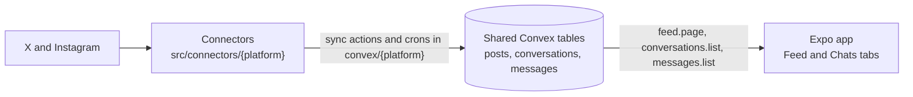

# Fomovoider

**All the good parts of social media. None of the slop.**

## The problem

Social apps are built to keep you scrolling. You open them for posts from people you follow and for your messages, and you leave an hour later having seen mostly things you never asked for.

## The idea

Fomovoider is a mobile app meant to be the only interface you use for social media. Uninstall Twitter/X, Instagram and the rest, keep Fomovoider, and you still get what matters without the distraction.

It has exactly two tabs:

- **Feed**: posts from Twitter/X, Instagram and other platforms in one finite feed. It ends. No infinite scroll.
- **Chats**: your DMs from all those platforms, gathered in one inbox.

## Principles

- **Finite by design.** The feed has an end, and reaching it means you're done.
- **One app.** One place for every platform, instead of many apps competing for your attention.
- **Simple.** Two tabs. Nothing else.

## Status

Fomovoider covers two platforms: X and Instagram.

**On main today**

- **Accounts**: sign up and sign in with email and password, then answer "What's slop for you?" once (editable from the Feed header). Sign in with Apple and Google is written but commented out until OAuth credentials exist.
- **Connect**: until one platform is connected, the app shows a Connect screen instead of the tabs, with a row for X (X's own sign-in) and one for Instagram (instagram.com's own login page, shown full screen inside the app with a Close button).
- **Settings** (gear in the native header): each platform's handle, status and last sync, Sync now for X (and for an Instagram account still read by the Mac host agent, which also gets a link to switch to the in-app login), Refresh now for Instagram (showing the outcome with post and story counts, plus a paused line while Instagram refreshes are switched off or paused after a tripwire), Disconnect (which deletes that platform's data from Fomovoider), and Sign out.
- **Chats tab**: the inbox and a conversation screen, with X conversations (Instagram DMs aren't synced yet), sending X DMs and replies, and pending or failed delivery shown on each message. Encrypted X Chat conversations are decrypted on the phone after the user unlocks them; Convex only stores ciphertext.
- **Feed tab**: the signed-in user's finite feed from Convex (`feed.page`), newest first across platforms, with skeletons while it loads. It ends at "You're all caught up", which also marks where the next session starts. Pull to refresh re-queries and asks each connector with a sync mutation to sync. Posts are marked seen as they scroll into view and opened when you tap the platform icon; long-press a post to save or hide it. Stories and tagged places show quietly on the card. A connected account in trouble (signed out, X credits used up) shows as a one-line notice above the feed. `/feed-preview` renders the same post component with sample data for design work.
- **Backend** on Convex: Convex Auth with email and password, connected accounts, the shared `posts`, `postStates`, `conversations` and `messages` tables, `feed.page` with the finite cutoff, media copies in Convex file storage, a daily retention cron, and the registration points connectors use for their own tables and crons. See [convex/README.md](convex/README.md).
- **X connector** (`src/connectors/x/`, `convex/x/`): official X API v2 with OAuth 2.0 PKCE, the code exchanged on the server, a 6-hourly sync of the home feed, mentions and DMs, and DM sends. The shared dev deployment holds real X posts and DMs from a team account.
- **Instagram connector** (`src/instagram/`, `convex/instagram/`): read-only. A hidden instagram.com web view in the app (`InstagramWebViewHost`, mounted in `app/_layout.tsx`) reads the Following feed and stories with the user's own session when the app opens or on Refresh now, and sends them to Convex; Instagram's cookies never leave the phone. See [src/instagram/README.md](src/instagram/README.md). The older Mac host agent (`hosts/instagram/`) that drives a paired iPhone stays in the backend as a fallback, with no pairing UI in the app.

**In open pull requests**

- #27: drop the `steps` login kind from the connector contract.
- #28: let connectors pass `Media.storageId` for post media.

**Planned**

App-side filtering of the feed. Connectors extract and store; deciding what is slop is the app's job.

## Architecture



- **App**: Expo (React Native, TypeScript) with Expo Router and react-native-reusables on NativeWind. `app/_layout.tsx` picks the screen from the `users.viewer` query: sign up or sign in, Connect, or the tabs under the native stack header. Every Convex query it subscribes to is scoped to the signed-in user, and `lib/connectors.ts` lists the platforms it can connect and how each signs in.
- **Backend**: [Convex](https://convex.dev) holds accounts, sessions and normalized content, and schedules every sync from crons.
- **Connectors** turn one platform into the shared types in [src/connectors/types.ts](src/connectors/types.ts) (`Post`, `Conversation`, `Message`, `Person`), with namespaced ids like `x:123` and typed errors, and write only through the shared ingest functions. X runs inside Convex actions; Instagram's web view in the app reports to Convex mutations as the signed-in user. Each connector's own code and tables live in `convex/<platform>/`, registered with one schema spread and one cron call.
- **Finite feed**: `feed.page` merges every platform newest first and stops where the user last caught up. Connectors return what is new since a cursor and report when they are caught up; nothing pages infinitely. The Feed tab pages through `feed.page` with `usePaginatedQuery`, reads `feed.connectorsCaughtUp` to know when the last page is the end, and calls `feed.markCaughtUp` when the user reaches it. What the user does with each post (seen, opened, hidden, saved) goes to `postStates`.
- **Filtering happens in the app.** Connectors extract and store, and never rank or filter for quality.

## Development

The app is an [Expo](https://expo.dev) (SDK 58) React Native project written in TypeScript. You need Node.js 22.13+ or 24.3+.

```bash
npm install        # install dependencies
npm start          # start the Expo dev server, then scan the QR code with Expo Go
npm run android    # or open on an Android emulator/device
npm run ios        # or open on an iOS simulator (macOS only)
npx tsc --noEmit   # typecheck
npm test           # unit and Convex backend tests (vitest, convex-test)
```

Add packages with `npx expo install <package>` so versions stay compatible with the Expo SDK.

### Convex

The app reads its backend URL from `EXPO_PUBLIC_CONVEX_URL`; copy `.env.example` to `.env.local` to point it at the shared dev deployment.

```bash
npx convex dev --local            # run unmerged backend code on a local backend
npx convex codegen                # regenerate convex/_generated
npx tsc --noEmit -p convex        # typecheck the backend
```

The shared dev deployment only runs main. Deploy it (`npx convex deploy`, authenticated by `CONVEX_DEPLOY_KEY`) only from main, or from a branch just rebased onto main whose PR is about to merge, because a deploy replaces every other team's functions, crons and indexes. Never commit or print `CONVEX_DEPLOY_KEY`. Connector env vars (such as `X_CLIENT_ID`) are set on the Convex deployment; see each connector's README.

## Install on your iPhone

We install with Xcode and a free Apple ID for now; there's no TestFlight yet. You need a Mac, an iPhone, and a USB cable.

1. Install Xcode from the Mac App Store, open it once, and let it install its components.
2. In Xcode → Settings → Accounts, add your Apple ID. A free Apple ID shows up as a "Personal Team".
3. A free team can't reuse a bundle ID that belongs to someone else's team, so pick your own. Put it in `.env.local` (gitignored):

   ```bash
   IOS_BUNDLE_ID=com.<yourname>.fomovoider
   # Optional: your team ID, if Xcode has more than one team for you
   # APPLE_TEAM_ID=XXXXXXXXXX
   ```

   Nico can skip this step, because the default is `com.nicopujia.fomovoider`.
4. Plug the iPhone into the Mac, unlock it, and tap **Trust** if it asks.
5. On the iPhone, turn on Settings → Privacy & Security → Developer Mode and restart when it asks. The option only shows up after the phone has been connected to Xcode once.
6. From the repo, run:

   ```bash
   npm install
   npm run ios:device
   ```

   This regenerates `ios/` from the app config and builds a Release build onto the phone. It talks to the shared dev deployment (`groovy-bobcat-759`), with the X client ID baked in, so it doesn't need Metro or your laptop after install. Pick your phone if it asks for a device, and your Personal Team if it asks for a signing identity.
7. The first launch is blocked until you trust yourself as a developer: Settings → General → VPN & Device Management → your Apple ID → **Trust**.

Apps signed by a free team expire after 7 days. When the app stops opening, plug in the phone and run `npm run ios:device` again. Your data lives on the server, so nothing is lost. A free team can also have at most 3 sideloaded apps on a phone at once.

X sign-in works with any bundle ID, because X redirects to the `fomovoider://oauth/x` URL scheme, which every build registers whatever its bundle ID is.

`eas.json` already holds a store build profile for when we move to TestFlight.
