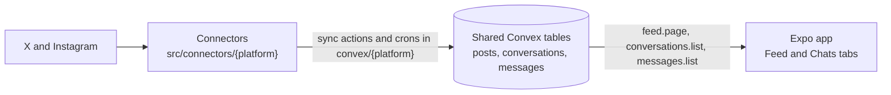

# Fomovoider

**All the good parts of social media. None of the slop.**

## The problem

Social apps are built to keep you scrolling. You open them for posts from people you follow and for your messages, and you leave an hour later having seen mostly things you never asked for.

## The idea

Fomovoider is a mobile app meant to be the only interface you use for social media. Uninstall Twitter/X, Instagram and the rest, keep Fomovoider, and you still get what matters without the distraction.

It has exactly two tabs:

- **Feed**: posts from Twitter/X, Instagram and other platforms in one finite feed. It ends. No infinite scroll.
- **Chats**: your DMs from all those platforms, gathered in one inbox.

## Principles

- **Finite by design.** The feed has an end, and reaching it means you're done.
- **One app.** One place for every platform, instead of many apps competing for your attention.
- **Simple.** Two tabs. Nothing else.

## Status

Fomovoider covers two platforms: X and Instagram.

**On main today**

- **Chats tab**: the inbox and a conversation screen, with X conversations (Instagram DMs aren't synced yet), sending X DMs and replies, and pending or failed delivery shown on each message. Encrypted X Chat conversations are decrypted on the phone after the user unlocks them; Convex only stores ciphertext.
- **Feed tab**: still an empty state. The feed component (post cards with media, skeletons, and a `PlatformBadge` that links to the original post) renders sample posts at `/feed-preview`.
- **Backend** on Convex: Convex Auth (anonymous sign-in for dev builds), connected accounts, the shared `posts`, `postStates`, `conversations` and `messages` tables, `feed.page` with the finite cutoff, media copies in Convex file storage, a daily retention cron, and the registration points connectors use for their own tables and crons. See [convex/README.md](convex/README.md).
- **X connector** (`src/connectors/x/`, `convex/x/`): official X API v2 with OAuth 2.0 PKCE, the code exchanged on the server, a 6-hourly sync of the home feed, mentions and DMs, and DM sends. The shared dev deployment holds real X posts and DMs from a team account.
- **Instagram connector** (`convex/instagram/`, `hosts/instagram/`): read-only. A host agent on a Mac drives the Instagram app on the user's paired iPhone through WebDriverAgent and sends posts and stories to Convex on runs that Convex schedules.

**In open pull requests**

- #11: account sign-up, connect gate, and Settings.
- #23: Sign in with Apple and Google, and onboarding that asks new users what counts as slop for them.
- #25: the Feed tab on real data, with the finite feed, post state, and account notices.
- #27: drop the `steps` login kind from the connector contract.

**Planned**

App-side filtering of the feed. Connectors extract and store; deciding what is slop is the app's job.

## Architecture



- **App**: Expo (React Native, TypeScript) with Expo Router and NativeWind. It subscribes to Convex queries scoped to the signed-in user.
- **Backend**: [Convex](https://convex.dev) holds accounts, sessions and normalized content, and schedules every sync from crons.
- **Connectors** turn one platform into the shared types in [src/connectors/types.ts](src/connectors/types.ts) (`Post`, `Conversation`, `Message`, `Person`), with namespaced ids like `x:123` and typed errors, and write only through the shared ingest functions. X runs inside Convex actions; Instagram's host agent reports to Convex mutations from the Mac. Each connector's own code and tables live in `convex/<platform>/`, registered with one schema spread and one cron call.
- **Finite feed**: `feed.page` merges every platform newest first and stops where the user last caught up. Connectors return what is new since a cursor and report when they are caught up; nothing pages infinitely.
- **Filtering happens in the app.** Connectors extract and store, and never rank or filter for quality.

## Development

The app is an [Expo](https://expo.dev) (SDK 58) React Native project written in TypeScript. You need Node.js 22.13+ or 24.3+.

```bash
npm install        # install dependencies
npm start          # start the Expo dev server, then scan the QR code with Expo Go
npm run android    # or open on an Android emulator/device
npm run ios        # or open on an iOS simulator (macOS only)
npx tsc --noEmit   # typecheck
npm test           # unit and Convex backend tests (vitest, convex-test)
```

Add packages with `npx expo install <package>` so versions stay compatible with the Expo SDK.

### Convex

The app reads its backend URL from `EXPO_PUBLIC_CONVEX_URL`; copy `.env.example` to `.env.local` to point it at the shared dev deployment.

```bash
npx convex dev --local            # run unmerged backend code on a local backend
npx convex codegen                # regenerate convex/_generated
npx tsc --noEmit -p convex        # typecheck the backend
```

The shared dev deployment only runs main. Deploy it (`npx convex deploy`, authenticated by `CONVEX_DEPLOY_KEY`) only from main, or from a branch just rebased onto main whose PR is about to merge, because a deploy replaces every other team's functions, crons and indexes. Never commit or print `CONVEX_DEPLOY_KEY`. Connector env vars (such as `X_CLIENT_ID`) are set on the Convex deployment; see each connector's README.
