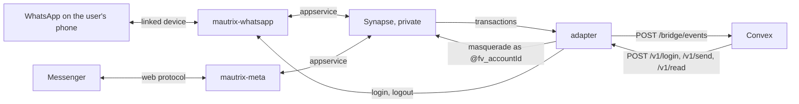

# Bridge host

An always-on service that keeps live WhatsApp (and Messenger) sessions for
connected accounts and feeds them into Convex. It runs the open-source mautrix
bridges, which speak Matrix, plus a private Matrix homeserver that nobody logs
into, plus an **adapter** that turns bridged Matrix rooms into the connector
contract's `Conversation` and `Message` and pushes them to Convex.



Everything secret (WhatsApp device keys, Meta cookies) stays in the bridge
databases on this host. Convex only holds a `device` session whose
`deviceId` points at a `bridge_devices` row.

## Running it

```bash
cd bridge
CONVEX_SITE_URL=https://<deployment>.convex.site ./scripts/init.sh   # writes .env with fresh tokens
docker compose up -d --build                                        # add --profile messenger for Messenger
npx convex env set BRIDGE_SECRET <BRIDGE_SECRET from .env>
npx convex env set BRIDGE_URL https://<public URL of the adapter, port 8080>
```

Only the adapter's port is published. For local development against
`npx convex dev` (local backend), keep the default
`CONVEX_SITE_URL=http://host.docker.internal:3211` and set
`BRIDGE_URL=http://127.0.0.1:8080`.

| Service | What it is |
| --- | --- |
| `registrations` | One-shot: renders the appservice registrations from `.env`. |
| `synapse` | Homeserver `bridge.local`, SQLite, no federation, no registration, no published port. |
| `whatsapp` | mautrix-whatsapp (bridgev2), SQLite. Config: `whatsapp/config.yaml`. |
| `messenger` | mautrix-meta, opt-in profile. Config: `messenger/config.yaml`. |
| `adapter` | `adapter/`, Node 24, no runtime dependencies. |

## How the adapter works

- Each Convex `connectedAccounts` id gets a Matrix user `@fv_<accountId>:bridge.local`
  in the adapter's exclusive appservice namespace. The adapter acts as those
  users by masquerading, so it holds no per-user tokens, and the bridges
  double-puppet through the same appservice token, so messages sent from the
  phone appear as the owner's own (`isMine`).
- **Pairing**: `POST /v1/login { method: "qr" | "phone", phone? }` logs out any
  previous login of the account, starts the bridge's provisioning login and
  returns the first contract `LoginStep`: `qr { url, expiresAt }` or
  `showCode { code, expiresAt }`. It keeps waiting on the bridge and pushes each
  refreshed step, then `connected` with the remote identity, or `failed`.
- **Receive**: Synapse pushes every event in rooms the account's user is in.
  Rooms carrying `m.bridge` state are portals: conversation id
  `<platform>:<chat id>` (the WhatsApp JID), message id `<platform>:<Matrix event id>`.
  Edits update the original message. Attachments become their caption or a
  placeholder (`[photo]`) because `mxc://` media isn't reachable by the app yet.
  When it first sees a room (after an invite or a restart) it catches up on the
  last 50 messages. Updates are batched per account and delivered in order.
- **Send**: `POST /v1/send` posts `m.room.message` as the owner and waits up to
  15 s for the bridge's `com.beeper.message_send_status`; a `FAIL` becomes an
  error for Convex. `POST /v1/read` sends a read receipt, which the bridge
  forwards.
- **Logout**: the bridges POST login state to `/bridge-status/<platform>`;
  `LOGGED_OUT` or `BAD_CREDENTIALS` for the current login pushes `logged_out`
  and Convex marks the account `expired`.
- Its only state is `/data/state.json`: which accounts it serves and their
  remote identity. Rooms are re-read from Matrix.

Auth: Synapse calls it with the adapter `hs_token`, bridges with their
`as_token`, Convex with `BRIDGE_SECRET`; Convex's `/bridge/events` checks the
same `BRIDGE_SECRET`.

## Convex side (`convex/bridge/`)

- `pairing.start({ platform, input: { method: "qr" } | { method: "phone", phone } })`
  (action, signed in): creates the user's device row, stores the `device` session
  with `internal.accounts.connectDevice`, and asks the adapter to start pairing.
- `pairing.status({ platform })` (query): `{ status, step, error }`. `step` is the
  contract's `LoginStep`: `qr` (render `url` as a QR code) or `showCode` (show
  `code` to type into WhatsApp > Linked devices > Link with phone number).
- Every use of a bridge account (events, send, markRead) re-checks that its
  device row belongs to the account's user.
- `POST /bridge/events` (HTTP action) → `internal.bridge.events.apply`:
  pairing/connected/failed/logged_out/sync, one transaction per event, only for
  accounts whose session points at their device.
- `internal.bridge.send.send` / `markRead` for `messages.send`.

## Checks

```bash
cd bridge/adapter && npm ci && npm test   # mapping and adapter flows
npm test                                   # convex/bridge/bridge.test.ts at the repo root
```

`scripts/synthetic-portal.mjs` impersonates the WhatsApp bridge (bridge bot,
`m.bridge` state, a ghost user) to drive real ingest through Synapse, the
adapter and Convex without a phone.
