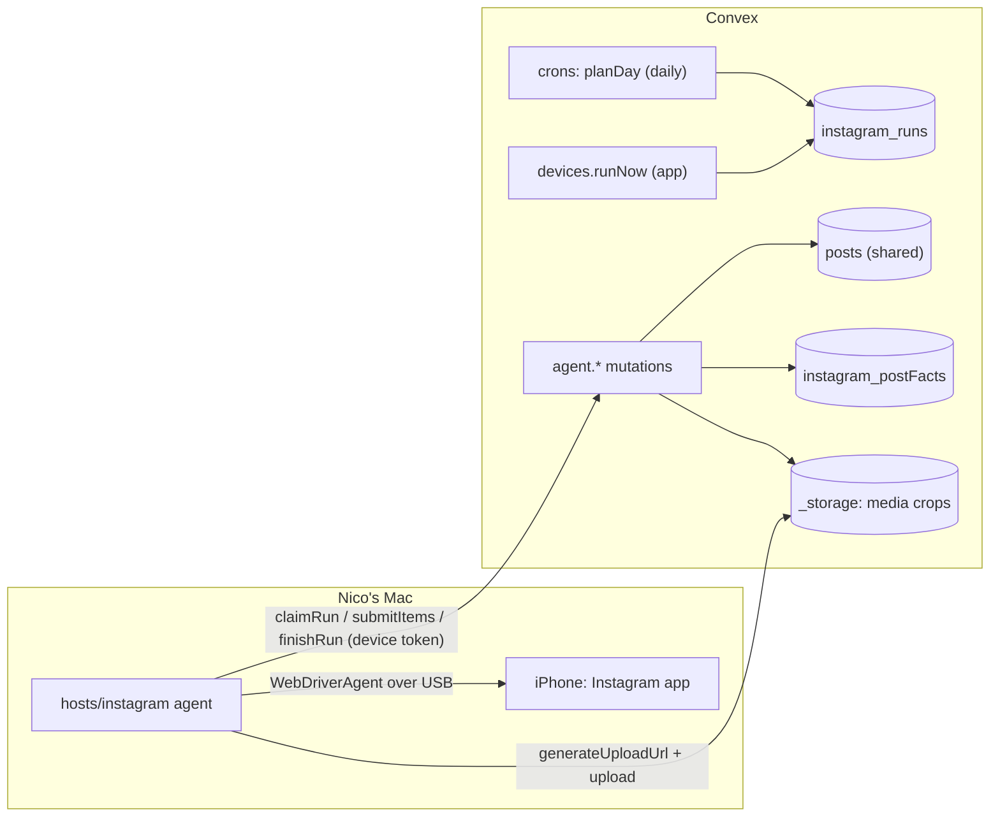

# Instagram connector (device-driven)

Instagram has no API we can use, so this connector reads the real Instagram iOS app on the user's own logged-in iPhone. A host agent on a Mac drives the phone through WebDriverAgent (XCUITest), reads each screen's accessibility tree, crops the media out of screenshots, and sends normalized posts and stories to Convex. Convex decides **when** a run happens and **what budget** it gets; the agent decides **how** it moves.

The connector only extracts and stores. It does no scoring, ranking or filtering: ads, suggested posts and reels are stored like everything else, with what the screen said about them recorded in `instagram_postFacts`.



## What gets captured

| Field | Feed post | Story frame |
| --- | --- | --- |
| `author` | header (`Post by <handle>`) | story header |
| `text` | caption as shown (truncated at "… more") | sticker labels (mentions, places, links) |
| `media` | crop of the photo, or a reel's cover, stored in Convex storage | crop of the frame |
| `createdAt` | relative age on screen ("2 days ago") | relative age ("19 hours ago") |
| `expiresAt` | - | `createdAt + 24 h` |
| `extracted.place` | location tag ("taken at …") | - |
| `format` | `post` | `story` |
| `instagram_postFacts` | `sponsored`, `suggested`, `isReel`, `followsAuthor` | `sponsored`, `storyTrayPosition` |

Ids are `instagram:<sha1>` of author, media label and caption (posts) or author, hour, frame index and stickers (stories); Instagram's own ids are not on screen. `permalink` is the author's profile or story URL.

## Anti-ban limits (enforced in the agent, budget also set by Convex)

- **Read-only.** Every tap goes through `guard.tap`, which only allows the feed tab, the profile tab, story tray cells and the story close button, and refuses anything matching the deny-list (Like, Follow, Comment, Share, Send, Save, Reply, Log out, Settings, …). Story frames advance by tapping the right edge at a point no sticker or control covers.
- **Human pacing.** Randomized dwell times; swipes are drags with 0.25-0.6 s duration and wobble.
- **Budget per run:** 8 minutes, 60 posts, 40 story frames (`limits.ts`).
- **Schedule:** 2 runs a day at 9:30 and 19:30 in the device's time zone, each ±45 min, planned daily by the `instagram plan scheduled runs` cron. Plus manual "Run now".
- **Tripwires.** Any challenge, login or "suspicious activity" screen aborts the run, pauses the device for 72 hours (`pausedUntil`) and marks the account `expired` (login/challenge) or `rate_limited` (warnings). Only text outside the feed and story viewer is checked, so a caption saying "try again later" does not trip it.
- **Never** logs in, logs out, or opens settings.
- **One surface at a time.** Before a run the agent checks `~/.capy/work/ig-account.lock` (`<owner> <pid>`) and `~/.capy/work/ig-account.last` (`<owner> <ISO end>`): it waits while another live process holds the lock or another surface was active less than 5 minutes ago, holds the lock for the run, and writes `.last` when done.

## Convex functions

Public, for the app (signed-in user): `instagram/devices:pair` → `{ code, expiresAt }` (the `Login { kind: "device", pair() }` flow; the app watches `status` until `paired`), `runNow`, `status`, `disconnect`.

Public, for the host agent (authenticated by a device token whose SHA-256 is stored at pairing): `instagram/agent:redeemPairing`, `claimRun`, `generateUploadUrl`, `reportIdentity` (calls `internal.accounts.verifyIdentity` with the profile tab's handle before any ingest), `submitItems` (calls `internal.ingest.upsertPosts`), `finishRun` (records the run, applies tripwire pauses, calls `internal.accounts.recordSync`).

Internal, for the CLI: `instagram/devices:pairForUser`, `runNowForUser`, `instagram/schedule:planDay`.

Tables (`schema.ts`): `instagram_devices`, `instagram_runs`, `instagram_postFacts`.

## Setup on the Mac (once)

1. iPhone: plugged in over USB, trusted, Developer Mode on, Instagram installed and logged in by hand.
2. Build WebDriverAgent (ships with Appium's XCUITest driver; `npm i -g appium && appium driver install xcuitest` or reuse `~/.appium`) with your team id:
   ```sh
   cd ~/.appium/node_modules/appium-xcuitest-driver/node_modules/appium-webdriveragent
   xcodebuild build-for-testing -project WebDriverAgent.xcodeproj -scheme WebDriverAgentRunner \
     -destination 'id=<UDID>' -derivedDataPath ~/.fomovoider/wda-derived-data -allowProvisioningUpdates \
     DEVELOPMENT_TEAM=<TEAM_ID> CODE_SIGN_STYLE=Automatic IPHONEOS_DEPLOYMENT_TARGET=15.0 \
     PRODUCT_BUNDLE_IDENTIFIER=com.<you>.WebDriverAgentRunner
   ```
   On the phone, trust the developer certificate once: Settings → General → VPN & Device Management. A free Apple ID's profile expires after 7 days; rebuild then.
3. Pair: get a code from the app's `pair()` (or `npx convex run instagram/devices:pairForUser '{"userId":"<users id>"}'`), then
   ```sh
   node hosts/instagram/index.ts pair --url https://<deployment>.convex.cloud --code <code> --udid <UDID>
   ```
   The token is written to `~/.fomovoider/instagram-agent.json` (mode 600); only its hash reaches Convex.

## Running

```sh
node hosts/instagram/index.ts daemon   # polls for due runs every ~minute; starts WebDriverAgent when needed
node hosts/instagram/index.ts once     # claim and execute one due run, then exit
npx convex run instagram/devices:runNowForUser '{"userId":"<users id>"}'   # queue a manual run
```

WebDriverAgent is reached over the CoreDevice tunnel (`xcrun devicectl device info details` → Tunnel IP Address, port 8100). It can take a minute to start.

## Checks

`npm test` (includes `convex/instagram/instagram.test.ts`), `node --test hosts/instagram/*.test.ts`, `npx tsc --noEmit -p convex`, `npx tsc --noEmit -p hosts/instagram`.

## Known limits

- Captions are stored as shown, truncated at "… more"; carousels store their first slide; reels store their cover frame.
- Times come from relative ages, so they are accurate to the unit shown (hours, days, weeks).
- The agent uploads each crop to Convex storage and sends its URL. Ingest's media persistence (`PERSIST_MEDIA.instagram`) then copies that URL into storage again, so each crop is stored twice and the agent's upload outlives post retention. The fix is a contract change: let connectors pass `storageId` on input media.
- Instagram changes its UI often. The parser keys on accessibility ids (`main-feed`, `header-view`, `media-cell`, `story-fullscreen-overlay-view`, `story-tray-cell-*`, `user-switch-title-button`) that were current in November 2026.
