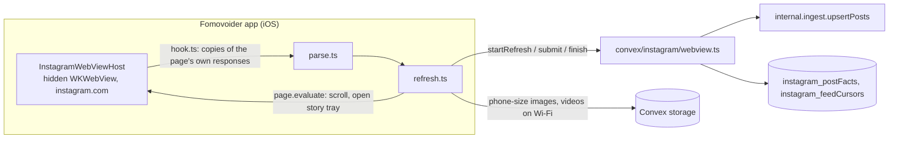

# Instagram via the in-app web view

Fomovoider reads the user's Instagram feed and stories from instagram.com inside a hidden web view in the Fomovoider app, using the user's own session on their own iPhone. Instagram doesn't need to be installed. Instagram's cookies stay in the web view's store on the phone; Convex only ever sees the captured posts.



## How a refresh works

1. **Permission.** `instagram/webview:startRefresh` checks the kill switch, the tripwire pause, one refresh at a time, spacing (app opens 10 min apart, background 3 h, Run now 2 min) and 12 a day. It returns the budget (4 min, 60 posts, 40 story items), the stored cursors and recent post ids.
2. **Following feed.** The host opens `instagram.com/?variant=following` (chronological). The first page comes server-rendered in the page's `<script type="application/json">` tags; later pages are the page's own `PolarisFeedRootPaginationCachedQuery` calls, triggered by scrolling about one screen at a time with 1.4-3.8 s pauses. Reading stops at the first post an earlier refresh stored (`caughtUp`), at the budget, or when the feed ends.
3. **Stories.** It scrolls back up, opens the story tray, and skips person by person (`Next`) while the page's own `PolarisStoriesV3ReelPageGalleryQuery` responses arrive, then closes the viewer. Opening a story marks it seen on Instagram, as it would for a person.
4. **Streaming.** After each step the new items go to `webview:submit`: images first upload from the phone (phone-size, ≤1080 px wide), videos only on Wi-Fi, and the post carries the `storageId`. A media file that fails to upload is sent by URL and ingest's media persistence copies it. The Following page cursor and the newest post id are saved per device.
5. **Finish.** `webview:finish` records the run. A tripwire pauses the device for 72 h and marks the account expired or rate limited.

Requests are instagram.com's own. The capture hook (`hook.ts`) wraps `fetch` and `XMLHttpRequest` only to read a clone of responses whose `fb_api_req_friendly_name` is in the capture list; it never sends, changes or delays a request, and never reads cookies or request headers. Navigation (`navigation.ts`) is limited to scrolling, opening the story tray, skipping to the next person and closing the viewer. Nothing likes, follows, replies or types.

## What gets captured

| Post field | Feed post | Story item |
| --- | --- | --- |
| `id` | `instagram:<media pk>` | `instagram:<story pk>` |
| `author` | `user`: id `instagram:<username>`, `displayName` = `full_name`, else the username | the reel's `user` |
| `text` | the full caption | mentions, hashtags, location and link stickers |
| `permalink` | `/p/<code>/` or `/reel/<code>/` | `/stories/<username>/<pk>/` |
| `media` | every carousel slide; videos with their poster as `previewUrl` | the frame or video |
| `createdAt`, `expiresAt` | `taken_at` | `taken_at`, `expiring_at` |
| `extracted.place` | `location` (name, lat, lng) | first location sticker |
| `sponsored` | an `ad` feed unit | an ad reel or item |
| `suggested` | an `explore_story` unit, or an author the viewer doesn't follow (unless they follow a co-author) | never |

`instagram_postFacts` also records `isReel`, `paidPartnership`, `followsAuthor` and `storyTrayPosition`. People-suggestion cards and end-of-feed markers are not posts and are only counted. Engagement counts are never read.

## Plug-in API (DMs and other capture modules)

There is one web view and one session. Other modules plug into the same host:

- **Capture:** pass extra GraphQL operation names, `<InstagramWebViewHost operations={[...DM_OPERATIONS]}>`. Their responses arrive as `{ type: "ig:response", operation, status, body }` messages; subscribe with `useInstagramWebView().onMessage(listener)` (returns an unsubscribe). Server-rendered data arrives as `ig:ssr` and URL changes as `ig:location`.
- **Driving the page:** only inside `useInstagramWebView().run(async (page) => { ... })`. Tasks run one at a time in order, so a DM send never interleaves with a feed refresh. `page.goto(url)` navigates and waits for the load; `page.evaluate(js)` runs an async function body in the page and returns its JSON result.
- **Safety:** call `tripwireFor(href, title)` on `ig:location` messages during your task and stop on a hit, and respect the kill switch (`api.instagram.webview.state` → `killSwitch`).

## App integration

- Mount `<InstagramWebViewHost>` once inside `ConvexClientProvider`. It renders nothing until the user starts the login or has a connected web-view account.
- Connect: `useInstagramWebView().showLogin()` shows the web view full screen on instagram.com's login page. Once the page shows a logged-in viewer, the host calls `webview:connect({ me })`, which creates the device session `{ kind: "device", deviceId }` (transport `webview`), confirms the identity, and hides the login.
- Settings: `refreshNow()` runs a refresh now; `api.instagram.devices.status` and `disconnect` work as before. `devices.runNow` queues a run the web view picks up on its next refresh.
- The app refreshes when it comes to the foreground. Background refresh (BGAppRefreshTask) is not wired yet.

## Kill switch

```sh
npx convex run instagram/killSwitch:set '{"enabled":true,"reason":"checkpoint seen"}'
npx convex run instagram/killSwitch:set '{"enabled":false}'
```

While on, `startRefresh` refuses, running refreshes abort at their next step (the app watches `webview:state`), `submit` throws, the Mac host agent gets `paused`, and `planDay` plans nothing.

## Tests

`npx vitest run src/instagram convex/instagram`. The fixtures in `__fixtures__/` are redacted captures from the FOMO-23 spike (instagram.com in a WKWebView, 2026-11-15). Only the fields the parser reads are kept, and every name, caption, id, URL and coordinate is replaced.

## Known limits

- Backfill past the budget continues on the next refresh by scrolling again from the top; the stored `endCursor` is not replayed, since that would need a request instagram.com didn't make itself.
- Off Wi-Fi, a video is sent by URL with no phone upload; ingest's media persistence copies it, and the poster stays a CDN URL (the contract has no preview `storageId`).
- Disconnecting stops refreshes and unmounts the web view, but the instagram.com cookies stay in the phone's web view store until the app is deleted.
- Story tray and viewer controls are found by link targets and accessibility labels (`a[href^="/stories/"]`, `Next`, `Close`) that were current in November 2026.
