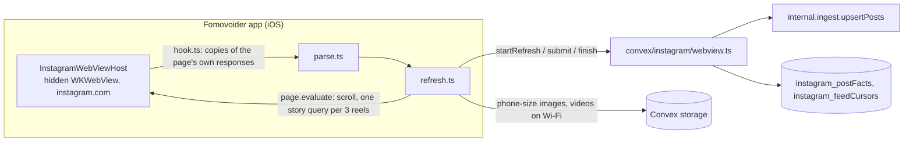

# Instagram via the in-app web view

Fomovoider reads the user's Instagram feed and stories from instagram.com inside a hidden web view in the Fomovoider app, using the user's own session on their own iPhone. Instagram doesn't need to be installed. Instagram's cookies stay in the web view's store on the phone; Convex only ever sees the captured posts.



## How a refresh works

This follows the FOMO-23 spike (`handoffs/instagram-webview-spike.md` in the Instagram Captain's drive).

1. **Permission.** `instagram/webview:startRefresh` checks the kill switch, the tripwire pause, one refresh at a time, spacing (app opens 10 min apart, background 3 h, Run now 2 min) and 12 a day. It returns the budget (4 min, 60 posts, 40 story items), the stored cursors and recent post ids.
2. **Story tray.** The host loads `instagram.com/` only for its server-rendered story tray and viewer (the ranked home feed in that page is not read).
3. **Following feed.** It loads `instagram.com/?variant=following` (chronological). The first page comes server-rendered in the page's `<script type="application/json">` tags; later pages are the page's own `PolarisFeedRootPaginationCachedQuery` calls, triggered by scrolling about one screen at a time with 1.4-3.8 s pauses. Instagram has no "newer than" cursor, so reading stops at the first post an earlier refresh stored (by id, or by `taken_at` if that post is gone), after 5 scrolled pages, at the budget, or at the end of the feed. Ads and suggestions never mark that point.
4. **Stories.** Opening the story viewer sends "seen" receipts, so it is never opened. Instead the hook sends `PolarisStoriesV3ReelPageGalleryQuery` itself, once per 3 tray reels updated since the last story pass (at most 3 queries), from inside the page: same endpoint, headers and form parameters (`fb_dtsg`, `lsd`, `__dyn`, ...) as the page's latest GraphQL request, with this query's name, root field, variables and doc id (read from the loaded bundle, with a fallback). This is the only request the connector issues itself.
5. **Streaming.** After each step the new items go to `webview:submit`: images first upload from the phone (phone-size, ≤1080 px wide), videos only on Wi-Fi, and the post carries the `storageId`. Each transfer gets the budget's remaining time (at most 30 s); past the budget, or when a transfer fails, media go by URL and ingest's media persistence copies them. The Following cursor (newest post id and time) and the stories cursor (latest reel update fetched) are saved per device.
6. **Finish.** `webview:finish` records the run. A tripwire pauses the device for 72 h and marks the account expired or rate limited.

Requests are instagram.com's own, except the story query above. The capture hook (`hook.ts`) wraps `fetch` and `XMLHttpRequest` only to read a clone of responses whose `fb_api_req_friendly_name` is in the capture list; it never changes or delays the page's requests and never reads cookies. Wrapped functions report the originals' native source, and the hook leaves no enumerable global. Navigation (`navigation.ts`) is limited to loading those two pages and scrolling. Nothing likes, follows, replies or types, and the web view only ever moves within instagram.com: "Open Instagram", App Store and `instagram://` links are refused.

## What gets captured

| Post field | Feed post | Story item |
| --- | --- | --- |
| `id` | `instagram:<media pk>` | `instagram:<story pk>` |
| `author` | `user`: id `instagram:<username>`, `displayName` = `full_name`, else the username | the reel's `user` |
| `text` | the full caption | mentions, hashtags, location and link stickers |
| `permalink` | `/p/<code>/` or `/reel/<code>/` | `/stories/<username>/<pk>/` |
| `media` | every carousel slide; videos with their poster as `previewUrl` | the frame or video |
| `createdAt`, `expiresAt` | `taken_at` | `taken_at`, `expiring_at` |
| `extracted.place` | `location` (name, lat, lng) | first location sticker |
| `sponsored` | an `ad` feed unit | an ad reel or item |
| `suggested` | an `explore_story` unit, or an author the viewer doesn't follow (unless they follow a co-author) | never |

`instagram_postFacts` also records `isReel`, `paidPartnership`, `followsAuthor` and `storyTrayPosition`. People-suggestion cards and end-of-feed markers are not posts and are only counted. Engagement counts are never read.

## Plug-in API (DMs and other capture modules)

There is one web view and one session. Other modules plug into the same host:

- **Capture:** pass extra GraphQL operation names, `<InstagramWebViewHost operations={[...DM_OPERATIONS]}>`. Their responses arrive as `{ type: "ig:response", operation, status, body }` messages; subscribe with `useInstagramWebView().onMessage(listener)` (returns an unsubscribe). Server-rendered data arrives as `ig:ssr` and URL changes as `ig:location`.
- **Driving the page:** only inside `useInstagramWebView().run(async (page) => { ... })`. Tasks run one at a time in order, so a DM send never interleaves with a feed refresh. `page.goto(url)` navigates and waits for the load; `page.evaluate(js)` runs an async function body in the page and returns its JSON result.
- **Safety:** call `tripwireFor(href, title)` on `ig:location` messages during your task and stop on a hit, and respect the kill switch (`api.instagram.webview.state` → `killSwitch`).

## App integration

- Mount `<InstagramWebViewHost>` once inside `ConvexClientProvider`. It renders nothing until the user starts the login or has a connected web-view account, and unmounts the page while the kill switch is on or the device is paused, so instagram.com runs nothing of its own then.
- The web view sits full size, attached to the window, behind the app's own screens (the spike found zero-size or detached web views stop loading). The app's screens must stay opaque.
- Connect: `useInstagramWebView().showLogin()` shows the web view full screen on instagram.com's login page, including any reCAPTCHA checkpoint. It stays visible until the page shows a logged-in viewer; then the host calls `webview:connect({ me })`, which creates the device session `{ kind: "device", deviceId }` (transport `webview`), confirms the identity, lifts a pause a login page caused, and hides the login. Switching a device to the web view revokes the Mac host agent's token and ends its runs; pairing the agent again does the reverse.
- Settings: `refreshNow()` runs a refresh now; `api.instagram.devices.status` and `disconnect` work as before. `devices.runNow` queues a run the web view picks up on its next refresh.
- The app refreshes when it comes to the foreground. Background refresh (BGAppRefreshTask) is not wired yet.

## Kill switch

```sh
npx convex run instagram/killSwitch:set '{"enabled":true,"reason":"checkpoint seen"}'
npx convex run instagram/killSwitch:set '{"enabled":false}'
```

While on, `startRefresh` refuses, running refreshes abort at their next step (the app watches `webview:state`), `submit` throws, the Mac host agent gets `paused`, and `planDay` plans nothing.

## Tests

`npx vitest run src/instagram convex/instagram`. The fixtures in `__fixtures__/` are redacted captures from the FOMO-23 spike (instagram.com in a WKWebView, 2026-11-15). Only the fields the parser reads are kept, and every name, caption, id, URL and coordinate is replaced.

## Known limits

- Backfill past the budget continues on the next refresh by scrolling again from the top; the stored `endCursor` is not replayed, since that would need a request instagram.com didn't make itself.
- Off Wi-Fi, a video is sent by URL with no phone upload; ingest's media persistence copies it, and the poster stays a CDN URL (the contract has no preview `storageId`).
- Disconnecting stops refreshes and unmounts the web view, but the instagram.com cookies stay in the phone's web view store until the app is deleted.
- When the user views a story in Fomovoider, nothing is sent to Instagram yet. Mirroring Instagram's "seen" (`PolarisAPIReelSeenMutation` through the page) is a follow-up.
- The page reports presence, so the user shows as active on Instagram while a refresh runs.
